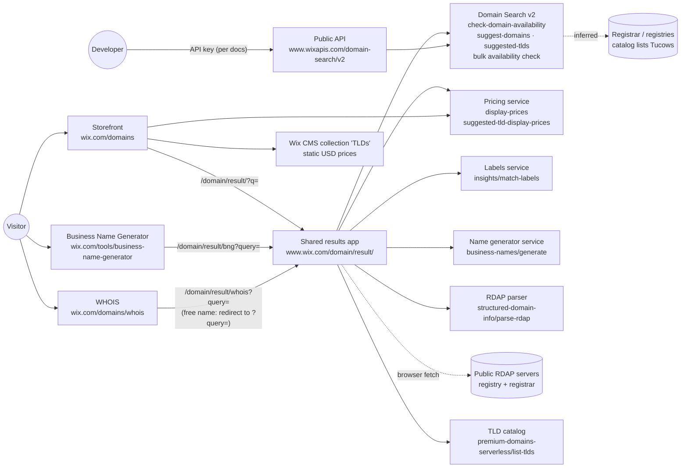

# Architecture: how Wix answers "Can I get this name?"

Mapped on 2026-11-01 from Israel. I recorded every XHR and fetch call while searching each door, using
headless Chromium (Playwright) and checking against Chrome DevTools. Test inputs were `google.com` (taken),
`qahw-k7x2m9p4.com` (free), `My Bakery!` (not a domain), and a business description in the name generator.
Raw captures are not in the repo, because they contain session tokens.

## The short version

1. **The three web doors are Wix sites** built on Wix's own platform: Velo code, CMS collections, and A/B
   experiments from `wix-laboratory-server`. They are entry pages only.
2. **All three hand off to one shared results app**, `www.wix.com/domain/result/`:
   - the storefront sends `?q=<term>`
   - the name generator sends `bng?query=<description>`
   - WHOIS sends `whois?query=<domain>`
3. **That results app and the public API call the same Domain Search v2 service.** The paths and response
   shapes are identical. The website calls it on `www.wix.com` as an anonymous visitor. The public API calls it
   on `www.wixapis.com`, and per the docs it needs an API key.
4. **Domain Search knows nothing about price.** Prices come from a separate serverless pricing service.
   It converts them to the visitor's local currency: I saw ₪.
5. **WHOIS doesn't use Domain Search for registered names.** It reads public RDAP records and asks a Wix
   service to parse them.

## Diagram

A solid line means I saw the call. A dotted line marked *inferred* means I didn't see it directly.

## Door 1: Domain storefront (`www.wix.com/domains`)

**What it is:** a Wix marketing site with a search box, TLD cards (.com, .net, .org…) and promo text.
Pressing **Search Domains** navigates to the shared results app with `?q=<term>`.

| Call (on page load) | What it returns | What it drives on screen |
|---|---|---|
| `GET /domains/_api/v1/access-tokens` | a visitor ID and session | nothing visible; anonymous session for the site |
| `GET /_api/wix-laboratory-server/laboratory/conductExperiment?key=specs.funnel.*` | an experiment variant | which header and dropdown variant you get (A/B tests) |
| `GET /domains/_api/cloud-data/v2/items/query` (collection `TLDs`) | TLD title, description, **static USD price** (`$7.90`) | the TLD cards |
| `POST /_serverless/domains-serverless-services/v1/display-prices` with `{domains:[a.com, a.net, …]}` | `price`, `originalPrice`, `pricingStrategy`, `renewalPrice` in **₪** | local prices on the cards, e.g. "Renews at ₪90.19" |
| `GET /_api/wix-html-login-webapp/user/getUserDetails` | "session not found" for visitors | "Log In" vs. the account menu |

Two price sources are on one page: the CMS holds fixed USD prices, and the pricing call overwrites them with
local prices. If the pricing call fails, the page can fall back to USD prices that don't apply to the visitor.

## The shared results app (`www.wix.com/domain/result/`)

This is where the question actually gets answered. Here's a search for `google.com`:

| Call | What it returns | What it drives on screen |
|---|---|---|
| `GET /domain-search/v2/check-domain-availability?domain=google.com` | `{available, premium, premiumType}` | the headline: **"Available now!"** or **"google.com is already registered."** |
| `GET /domain-search/v2/suggest-domains?query=google.com&paging.limit=10` | 10 × `{domain, premium}` | "Explore available alternatives" and the "Great Alternative" cards |
| `GET /domain-search/v2/suggested-tlds` | `["com","net","co.il","org",…]` (location-based: `co.il` is 3rd from Israel) | which other endings are offered |
| `POST /domain-search/v2/bulk/domain-availabilities/check` (several batches) | availability of the same name across many TLDs | other-ending rows |
| `POST /_serverless/domains-serverless-services/v1/suggested-tld-display-prices` | per TLD: `price ₪0.00`, `originalPrice ₪21.47`, `FREE_FIRST_YEAR`, `renewalPrice ₪90.19` | "~~₪21.47/yr~~ ₪0.00/yr · Free for 1 year" |
| `POST /_serverless/domains-serverless-services/v1/insights/match-labels` | one marketing label per suggestion (`MOST_POPULAR`, …) | badges such as "Most Popular" |
| `GET /_serverless/premium-domains-serverless/domain-tlds/list-tlds` | full TLD catalog: registrar (`TUCOWS`), privacy, transfer and renewal rules | no visible element of its own; it's the rules for what can be sold |
| `GET /_api/user-domains/v1/user_domains/{domain}` | **401** for visitors | nothing visible for a visitor (probably checks "you already own this" for logged-in users) |

When the input isn't a domain (`My Bakery!`), the app skips the availability check. It calls only
`suggest-domains`, which shows "Best Match: mybakery.co.il".

The buy buttons are "Make It Yours" for the exact match and "Get It" for alternatives. Neither was clicked.

## Door 2: Business Name Generator (`www.wix.com/tools/business-name-generator`)

**What it is:** a Wix site with a description box and a **Generate Names** button. It navigates to
`/domain/result/bng?query=<description>`.

| Call | What it returns | What it drives on screen |
|---|---|---|
| `POST /_serverless/domains-serverless-services/v1/business-names/generate` with `{query, excluding:[], count:9}` | 9 names, each with a one-line `reasoning` (AI-generated) | the name chips ("Bakery Bliss", "Dough", …) |
| `GET /domain-search/v2/suggest-domains?query=Bakery+Bliss&paging.limit=10` | domain suggestions for the **selected** name (the first one by default) | "Claim the perfect domain for 'Bakery Bliss'" |
| `insights/match-labels` + `suggested-tld-display-prices` | same as the results app | badges and prices |

The generator never calls `check-domain-availability` itself. It trusts `suggest-domains` to return only
available names. That's why the cross-check "suggested ⇒ really available" is in my test plan.

## Door 3: WHOIS lookup (`www.wix.com/domains/whois`)

**What it is:** a Wix site with one input, "Enter a domain name or URL".

**Registered domain** (`/domain/result/whois?query=google.com`):

| Call | What it returns | What it drives on screen |
|---|---|---|
| `GET https://rdap.markmonitor.com/rdap/domain/GOOGLE.COM`, called by the **browser directly** | the registrar's raw RDAP record | nothing directly |
| `POST /_serverless/domains-serverless-services/v1/structured-domain-info/parse-rdap`, sent twice: registry data, then registrar data | dates, nameservers, statuses, registrar, `registrant: REDACTED…` | "WHOIS Information": Created Sep 15, 1997 · Expires Sep 14, 2028 · nameservers · statuses |
| suggest + labels + prices | as above | "Explore some great alternatives below" |

**Free domain:** the page calls `check-domain-availability` first and then **redirects to the storefront
results** (`/domain/result/?query=…`). That page checks availability again, so it's the same check twice.

The registrant is shown as "REDACTED FOR PRIVACY". That's normal for most registered domains.

## Door 4: Public Domain Search API (`www.wixapis.com/domain-search/v2`)

| Endpoint | Input | Output |
|---|---|---|
| `GET /check-domain-availability` | `domain` (must include the TLD) | `{domain, available, premium, premiumType}` |
| `GET /suggest-domains` | `query`, `tlds` (no dot), `paging.limit` (1–50), `maxLength` | `{suggestions:[{domain, premium}], pagingMetadata}` |

- It's the same service, paths and response shapes that the web results app uses.
- It has **no price data**. A developer can learn that a name is free and premium, but not what it costs.
- The docs require an account-level API key plus a `wix-account-id` header. In practice, the calls also
  succeed with no key and with a fake key (see [FINDINGS.md](FINDINGS.md)).

## How the doors relate

- **One brain, four faces.** Every door ends up asking Domain Search v2. The doors differ only in what they
  ask first: an exact name, a business description, or a registered domain.
- **Price and labels are added only on the web.** The website enriches Domain Search results with the
  pricing service and the labels service. The public API returns raw Domain Search data.
- **Location changes the answer's shape:** currency (₪), the TLD order (`co.il` near the top) and
  suggestions (`.co.il` first for "My Bakery!").
- **Suggestions are generated.** The same query can return different names on different calls and at
  different doors.

## Not part of the answer (noise I filtered out)

Wix BI events (`frog.wix.com`), performance monitoring (`panorama.wixapps.net`), CSS and tag-manager calls,
review widgets, and third-party ad and analytics pixels (Google, DoubleClick, LinkedIn and others).

## What I couldn't see

- What's behind Domain Search: a live registry check or a cache. I inferred it from the TLD catalog only.
- Logged-in behavior: `user_domains` returns 401 for visitors.
- The checkout flow, which the rules say not to enter.
- Other countries. Everything here was seen from Israel.
