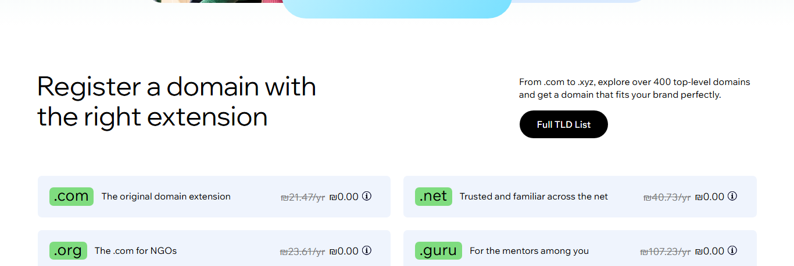
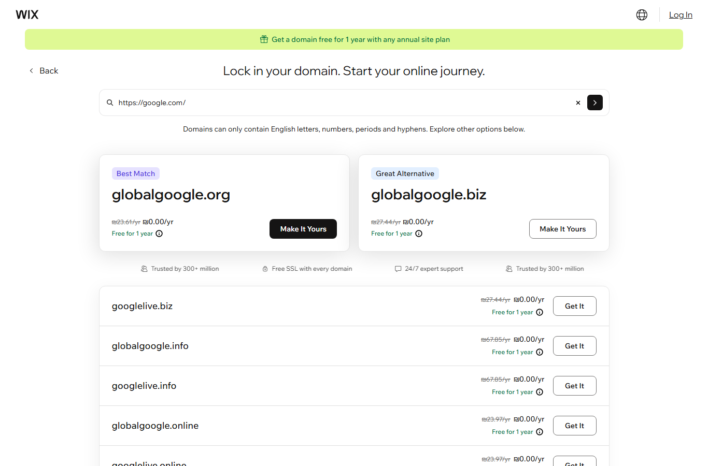
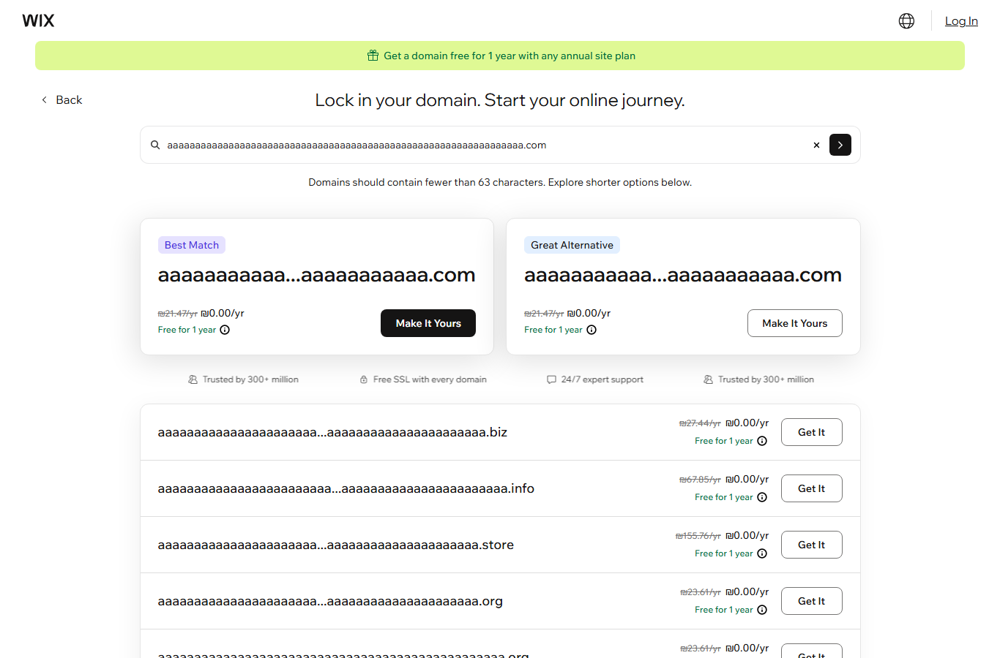

# Findings

Found on 2026-11-01, from Israel, logged out, in Chrome and with curl. Each one was reproduced at least twice.
Nothing here is invented, and expected behavior (redacted WHOIS, unsupported TLDs, prices by location)
is not reported as a bug.

**Severity** = how bad it is for the user or for Wix when it happens: High · Medium · Low.
**Priority** = how soon I'd fix it: **P1** this sprint · **P2** next sprint · **P3** backlog.
Priority weighs severity against how often it happens, how visible it is, and how cheap the fix is.

| # | Finding | Severity | Priority |
|---|---|---|---|
| 1 | Public API answers without a valid API key | Medium | P2 |
| 2 | Pricing call fails → storefront shows static USD prices to an Israeli visitor | Medium | P3 |
| 3 | Public API docs don't match the API's behavior (6 mismatches) | Low | P2 |
| 4 | Storefront input messages mislead: a pasted URL is "invalid", and the length limit is off by one | Low | P3 |
| 5 | Suggest Domains paging says "no next page" although more suggestions exist | Medium | P2 |

---

## 1. The public API answers without a valid API key

**Where:** `www.wixapis.com/domain-search/v2/check-domain-availability` and `/suggest-domains`

**Steps:**
```bash
curl "https://www.wixapis.com/domain-search/v2/check-domain-availability?domain=google.com"
curl "https://www.wixapis.com/domain-search/v2/check-domain-availability?domain=google.com" -H "Authorization: not-a-real-key"
curl "https://www.wixapis.com/domain-search/v2/suggest-domains?query=bakery&paging.limit=2"
```

**Expected:** the docs say *"This call requires an account level API key"*. Without a valid key, the call
should be rejected with 401 or 403.

**Actual:** all three return **HTTP 200** with full results:
```json
{"availability":{"domain":"google.com","available":false,"premium":false,"premiumType":"UNKNOWN_PREMIUM_TYPE"}}
```
The documented `wix-account-id` header isn't needed either. You can reproduce this by opening the first URL
in a browser.

**Severity: Medium.**
- There's no data leak. The website already gives the same answers to anonymous visitors.
- But the key is how Wix knows *who* is calling: per-partner quotas, blocking abuse, usage reporting, and
  revoking a partner. Without the check, any unknown caller can use the service at any volume. (I didn't
  test volume; the rules forbid it.)
- Partners who read the docs also believe the API is protected.

**Priority: P2.** It needs an owner's decision this sprint: enforce the key, or change the docs.
I'd raise it to P1 if Wix relies on keys for quotas or billing.

**In automation:** `tests/api/auth.spec.ts` asserts the *documented* behavior and is marked as a known
failure. The suite stays green, and the test will alert us when the behavior changes.

---

## 2. When the pricing call fails, the storefront shows static USD prices to a visitor in Israel

**Where:** `www.wix.com/domains`, section "Register a domain with the right extension"

**Steps:**
1. Open `https://www.wix.com/domains` in Chrome. Open DevTools → Network.
2. Right-click the `display-prices` request and choose **Block request URL**. Reload the page.
3. Scroll to the TLD cards.

**Expected:** local prices, as on a normal load (.com ~~₪21.47/yr~~ ₪0.00). Or, if prices can't be loaded,
no price at all.

**Actual:** .com ~~$7.90~~ $0.00, .net ~~$11.90~~, .guru ~~$30.95~~. These are in **USD**, and the amounts
come from a static CMS collection (`TLDs`), not from the pricing service. The "Renews at…" text also
disappears from the cards.

| Normal load | Pricing call blocked |
|---|---|
|  |  |

**Why it happens** (see [ARCHITECTURE.md](ARCHITECTURE.md)): the cards are drawn from the CMS with fixed
USD prices. The `display-prices` call then overwrites them with local prices. If that call fails, the CMS
prices stay on screen.

**Severity: Medium.** The visitor sees a price in the wrong currency and amount, and finds the real price
later in the funnel. That costs trust.

**Priority: P3.** It only shows when the pricing call fails, which is rare. The fix is small: hide the
prices until the live call returns.

---

## 3. The public API docs don't match the API's behavior

**Where:** the [Domain Search API reference](https://dev.wix.com/docs/api-reference/account-level/domains/domain-search/introduction)

| The docs say | The API does |
|---|---|
| Suggest `query` *"must not include the TLD"*; only letters, numbers, spaces, dots and hyphens, else `INVALID_QUERY` | `query=google.com` and `query=My Bakery!` both return 200 with suggestions. Wix's own storefront sends `query=google.com`. |
| Check `domain`: *"Max: 63 characters"* | A 64-character domain (60-letter label + `.com`) returns 200. The storefront checks 67-character domains (a 63-letter label + `.com`). 63 is the DNS limit **per label**, not per domain. |
| `paging.limit`: *"Min: 0"* | `paging.limit=0` → 400 *"expected 1 or more"*. The schema line on the same page says minimum 1. |
| `limit`: *"will be removed on March 1, 2025"* | Still works on 2026-11-01: `limit=2` returns 2 results. |
| `premiumType` values: `FIRST_YEAR_ONLY`, `FIRST_YEAR_AND_RENEWAL` | Every non-premium answer returns `"UNKNOWN_PREMIUM_TYPE"`, which isn't documented. |
| Check's only documented error: `INVALID_DOMAIN` | An unsupported TLD returns 400 `DOMAINS_UNSUPPORTED_TLD`, which isn't documented. |

**Severity: Low.** No end user is affected. But developers build against the docs:
- a client generated from the documented `premiumType` values can fail on `UNKNOWN_PREMIUM_TYPE`
- validation they expect simply doesn't happen

**Priority: P2.** Cheap to fix (docs, or validation), and partners integrate from these docs.

---

## 4. The storefront's input messages mislead the user

Two small issues with the same root: the input check on the results page.

**a) A pasted URL is called "invalid".** Search for `https://google.com/` on `www.wix.com/domains`.
- **Expected:** strip `https://` and the path, the way the storefront already strips `www.`, and answer
  "google.com is already registered". The WHOIS page on the same site accepts *"a domain name or URL"*.
- **Actual:** *"Domains can only contain English letters, numbers, periods and hyphens."* The network tab
  shows **no availability check at all**, only suggestions ("Best Match: globalgoogle.org"). The user never
  learns whether google.com is taken.

**b) The length message is off by one.** Search for a name with a 63-letter label, then a 64-letter one.

| Label length | Result |
|---|---|
| 63 | "Available now!", so it's accepted |
| 64 | *"Domains should contain **fewer than 63** characters."* That means 62 is the maximum, yet 63 was accepted. |

| Pasted URL | 64 characters |
|---|---|
|  |  |

**Severity: Low.** The workarounds are easy (delete `https://`, shorten the name), and only the wording is wrong.
**Priority: P3.**

---

## 5. Suggest Domains paging says "no next page" although more suggestions exist

**Where:** `GET www.wixapis.com/domain-search/v2/suggest-domains`

**Steps:**
```bash
curl "https://www.wixapis.com/domain-search/v2/suggest-domains?query=coffee&paging.limit=5"   # + key headers
curl "https://www.wixapis.com/domain-search/v2/suggest-domains?query=coffee&paging.limit=20"  # + key headers
```

**Expected:** if 20 suggestions exist, a page of 5 says `hasNext: true` and returns a `next` cursor.
`paging` is the documented way to page, because `limit` is deprecated.

**Actual:**

| Query | `paging.limit=5` | `paging.limit=20` |
|---|---|---|
| `coffee` | 5 results, `hasNext: false`, no cursor | **20 results**, `hasNext: false` |
| `bakery` | 5 results, `hasNext: false`, no cursor | **20 results**, `hasNext: false` |
| `my bakery` (two words) | 5 results, `hasNext: true`, cursor ✓ | n/a |

The single-word queries I tried never return a next page, while a two-word query does.

**Severity: Medium.** It fails silently: a partner that pages the documented way thinks it has seen
every suggestion, and shows its users only the first page. The workaround is to ask for one big page
(`paging.limit` up to 50), but nothing tells the partner to do that.

**Priority: P2.** It affects every partner that pages, and it's invisible without a test like the one in
`tests/api/suggest-domains.spec.ts` ("hasNext is true when more suggestions exist", marked as a known failure).

---

## Also noticed (risks and observations, not counted above)

- **The renewal price is only in a hover tooltip.** Results show ~~₪21.47/yr~~ **₪0.00/yr** "Free for 1 year".
  The .com renewal, **₪90.19/yr** (4.2× the crossed-out price), appears only when you hover the (i) icon.
  This isn't a bug, since it is disclosed. But the crossed-out "₪21.47/yr" reads like the normal yearly price,
  and touch screens have no hover. I'd raise it with product and legal.
  ([screenshot](evidence/obs-renewal-tooltip.png))
- **Wasted calls on every visit:**
  - Every logged-out search calls `user_domains`, which returns **401**.
  - The storefront and WHOIS pages call `getUserDetails` on a path that returns **404** on every load.
  - WHOIS for a free name checks availability twice: once before and once after the redirect.
- **What works well:**
  - Uppercase, `www.` and a trailing dot are all normalized.
  - `.gov` gets a clear "aren't available" message, and a leading hyphen gets a clear message.
  - HTML typed into the search (`<b>qa</b>`) is shown as text, not rendered.
